# Screens and output

> 15 screenshots, each captioned with what it proves rather than how it looks.

Back to [English README](../README.md) · [中文 README](../README.zh-CN.md)

All captured from a running instance, not mockups. The data comes from the
bundled synthetic examples and contains no real business information.

Re-capture them with `scripts/capture_screenshots.py` after any change to the console — a
screenshot that shows a layout the product no longer has is a claim the reader can check and
find false. The script pairs each route with the file the docs reference, reads the ids it needs
from the instance, and takes everything from the URL (`?tab=`, `?object=`, `?lang=`) so the same
command produces the same pictures.

**Two sets, one per language**: the console is bilingual, so this page shows English screens and
`docs/screenshots.zh-CN.md` shows the default ones. Both come from the same command:

```bash
python scripts/capture_screenshots.py --token "$TOKEN" --user "$USER"                     # 中文
python scripts/capture_screenshots.py --token "$TOKEN" --user "$USER" --out docs/images/en --lang en
```

`tests/test_documentation_links.py` holds both ends: every image the docs show must exist, every
file under `docs/images/` must be shown by a document, and an image captured in one language must
not be shown by a document in the other.

## Workbench: what to do next, in one screen

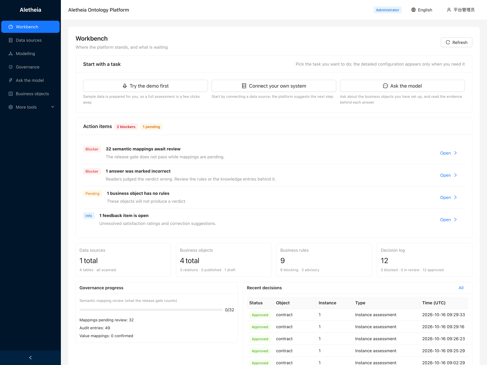

Action items are ordered blockers-first and each one links to the screen that
resolves it. Every figure is a read-only projection of existing tables, so the
workbench cannot disagree with the screens it summarises.

## Semantic Q&A: verdict, governing rules, evidence

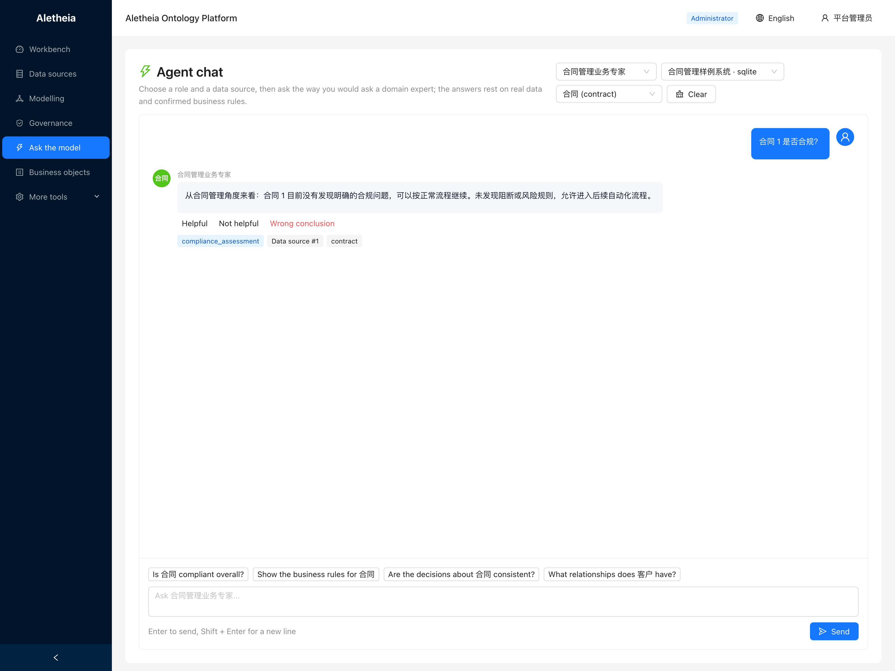

An answer comes back as a verdict with its evidence attached, not as a paragraph of prose: the
conclusion itself, and the tags naming what the platform understood -- the intent
(`compliance_assessment`), the source it read, the object it is about. Asking about rules or a
batch returns those as lists and tables instead, which is what the answer's renderer is for.

Every answer can be rated (helpful / not helpful / wrong), and the rating lands in the feedback
loop with the question attached -- which is where "the model was unhelpful and nobody noticed"
stops being possible.

The role shown (「合同管理业务专家」, contract-management expert) is derived at runtime from the
onboarded domain; no industry roles are built in.

## Data source onboarding and metadata scan

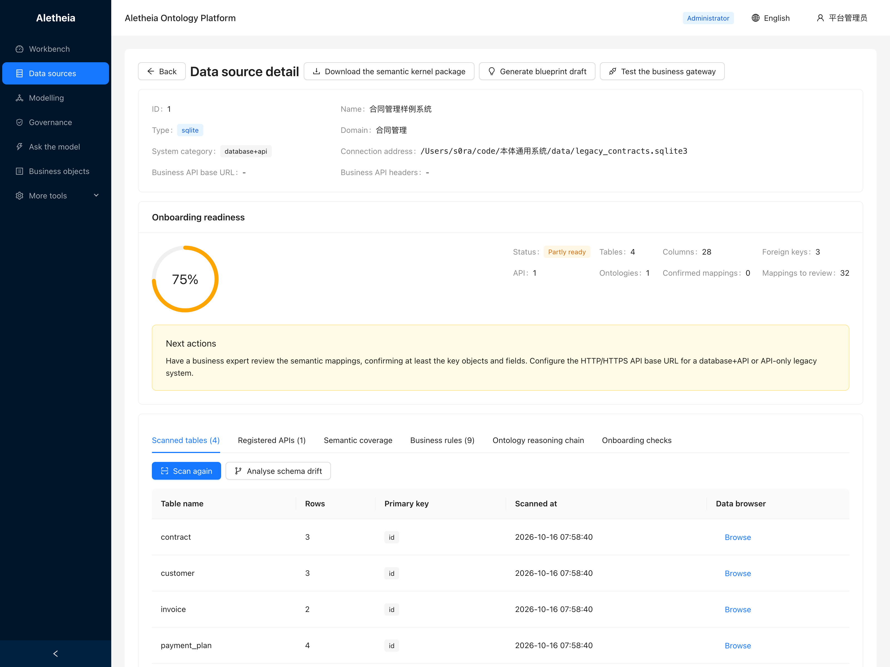

Tables, columns and foreign keys, counted and scored: what a scan read from an
existing database, with a readiness score and the next actions that follow from
it. The tabs below hold the scanned tables themselves and the API operations
registered against the source. A connection string carrying a password arrives
redacted; this one is a local file, which has none to show.

## Domain ontology and business objects

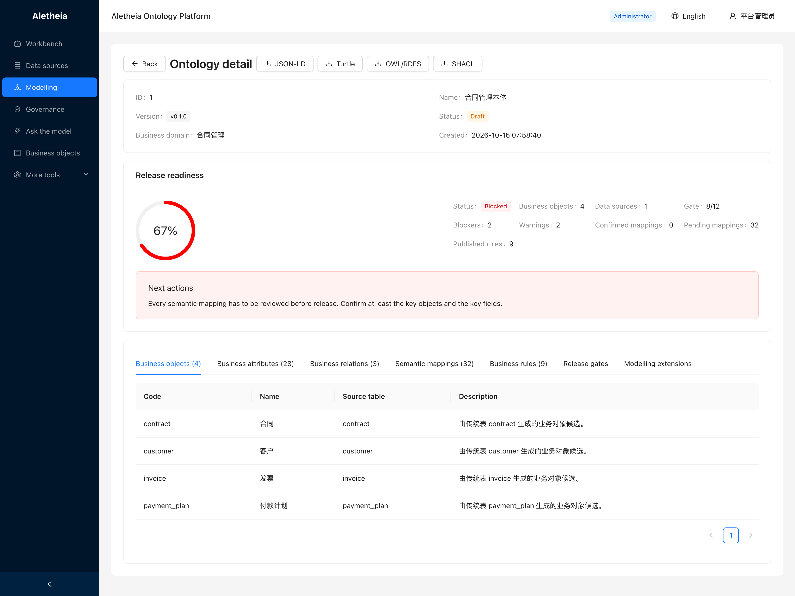

## Governance and the release gate

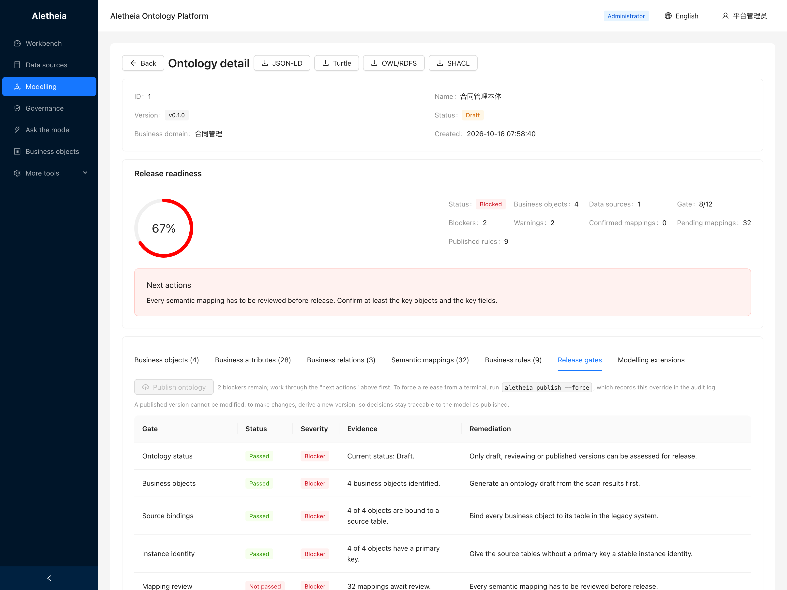

Publishing is refused while blocking gates are open; a `force` override is
written to the audit log together with the count of failed gates.

## Roles and object permissions

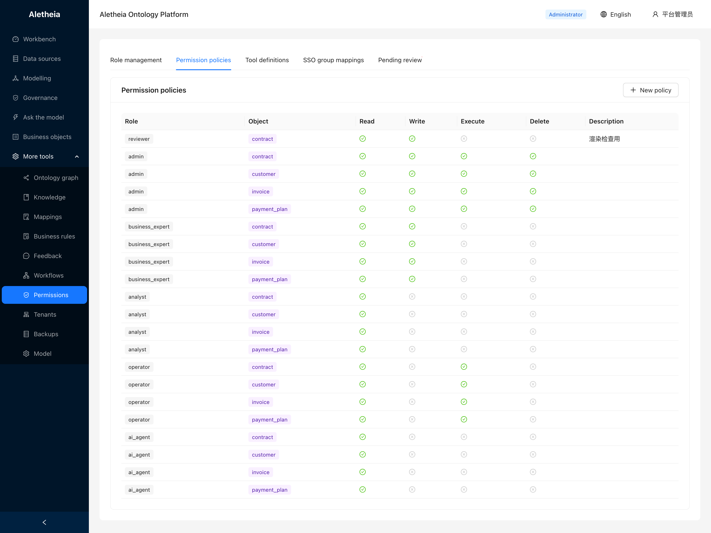

> A policy can carry a row-filter expression, and it **is enforced**: `check_permission` evaluates it
> in the rule sandbox, the object list applies it per candidate row and reports
> `rowFilterApplied`, and an expression that cannot be evaluated **denies** rather than allows.
> See [Current limitations](limitations.md) for what it costs (one row read per candidate).

## Knowledge graph preview

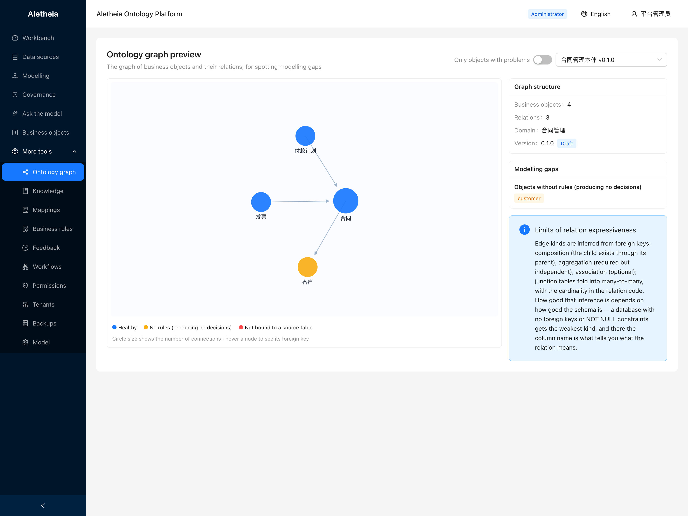

An ontology is a graph, but every other screen renders it as tables, which hides
the problems a reviewer needs to see: isolated objects nothing points at,
self-referencing hierarchies, and clusters that produce no verdict. Colour encodes
a diagnosis rather than decoration -- red for unbound to a source table, amber for
carries no rules. Edge kind is inferred from the key structure (composition /
aggregation / association), junction tables collapse to many-to-many, and the view
states that the quality of that classification is bounded by the quality of the
schema it read.

## Document knowledge base

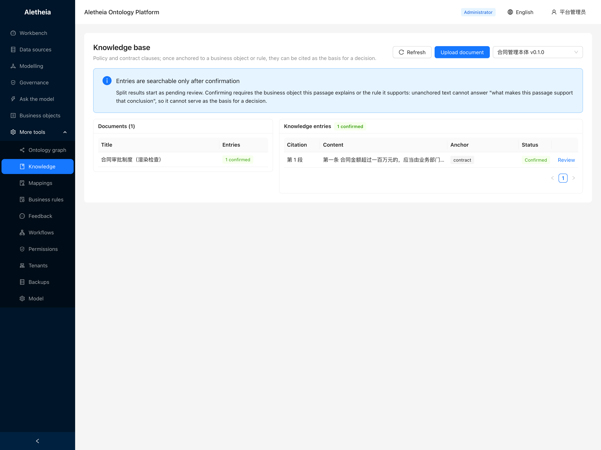

Policy and contract clauses are split on their numbering (`第3.2条`, `3.1`,
`一、`, `Article 7`), preserving a locator a human can quote. Two governance
constraints are enforced by the workflow:

1. **Entries are pending by default and are not retrievable until confirmed.** A
   mis-split clause that silently became judgement evidence would produce a
   verdict that looks sourced but is not -- worse than no citation.
2. **Confirming requires an anchor** (business object or rule). Unanchored text
   cannot answer "why does this passage support this verdict".

The document in the frame has been through both steps: one clause, confirmed,
anchored to `contract`.

Retrieval narrows by anchor *before* ranking, which is the opposite of searching
everything and inspecting the hits. That ordering is what makes a citation
attributable rather than merely similar.

## Feedback loop

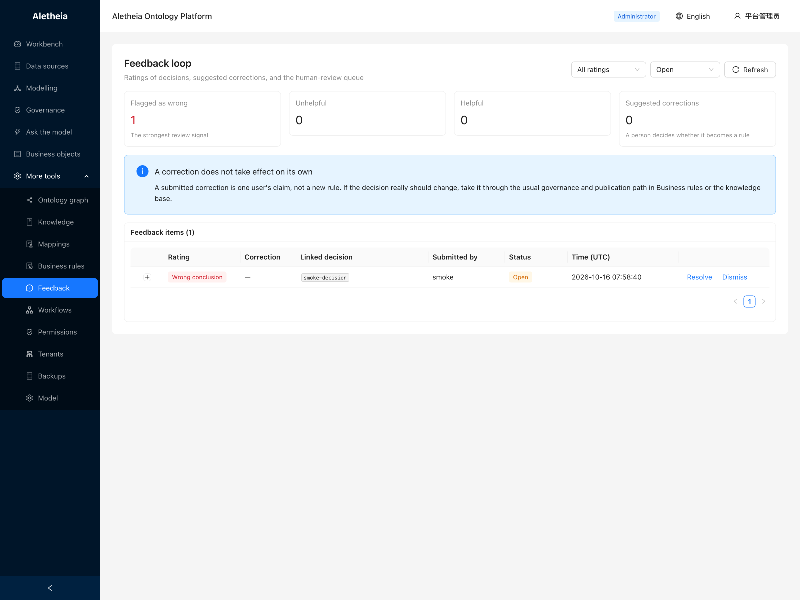

One queue, one row per item. The rating in the frame marks a conclusion a reader
called wrong and links back to the decision record it is about -- "this verdict is
wrong" is only actionable when you know which verdict.

Two deliberate omissions: there is no average satisfaction score, because an
average does not tell you which answer to fix; and there is no one-click "apply
correction", because a correction is one user's claim rather than a new rule, and
promoting it goes through governance (ADR-0002).

## Business objects and their governed instances

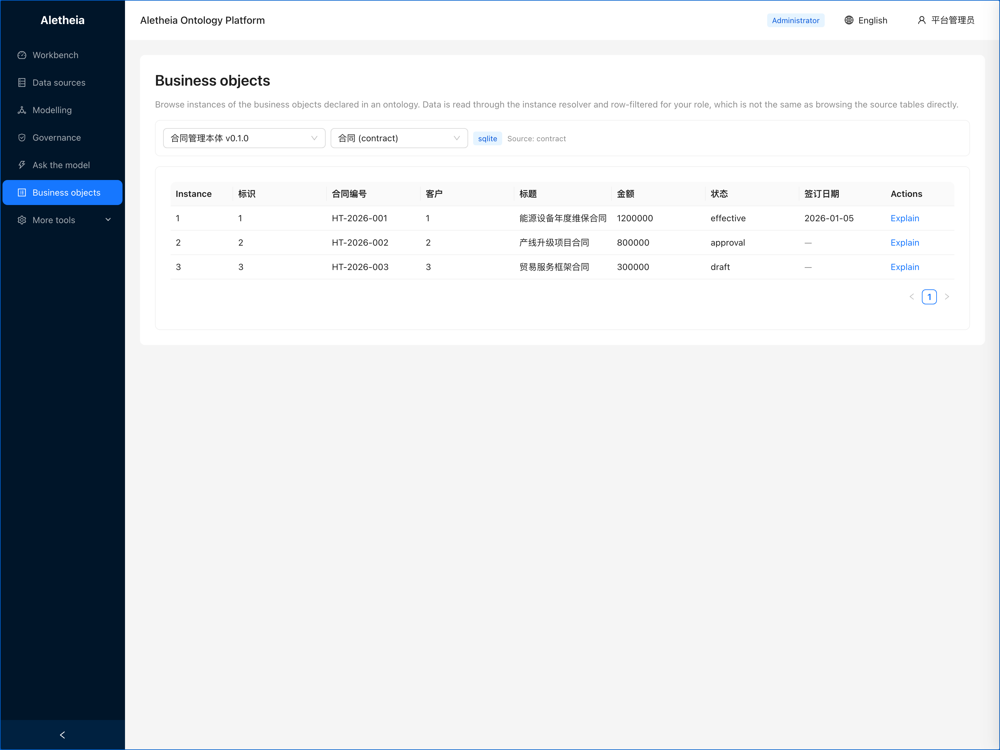

The one screen that shows a business object *as an object*: instances read through the
instance resolver, with the object's declared attributes as columns, and the caller's
row-level filter applied. The drawer on the right is a single instance: its values, each naming
the source column it was read from, and the events recorded against it -- with its value history
below those. Browsing the raw source table is a different thing -- it skips the
resolver, skips the filter, and shows columns rather than the modelled contract.

An empty table says which of the two reasons applies. "Nothing is visible to your role" and
"your filter expression could not be evaluated" both leave no rows, and only the second is a
misconfiguration someone can fix, so it is stated rather than left to inference.

## Tenants and their quotas

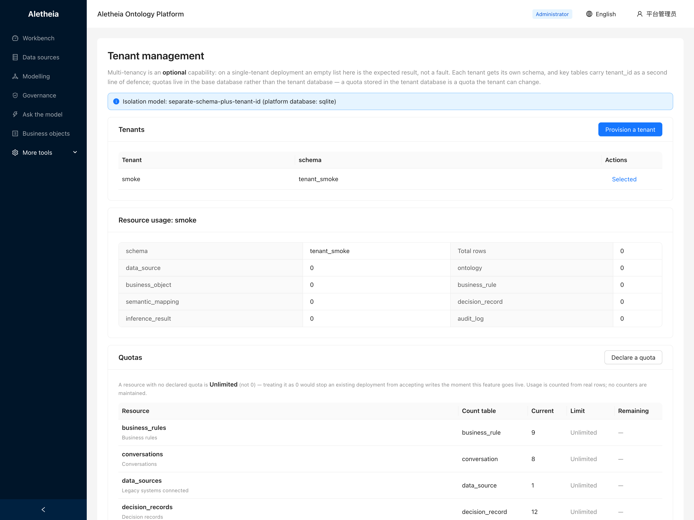

Multi-tenancy is opt-in, so an empty list on a single-tenant deployment is the expected
answer rather than a failure. The page says so, names the isolation model in force, and shows
usage beside limits -- a limit without usage cannot answer the question an operator has, which
is "is this tenant about to be blocked". A resource with no declared limit is rendered as
**Unlimited** rather than as a large number or as zero -- an unset quota permits the write,
deliberately.

## The audit report: the questions an auditor arrives with

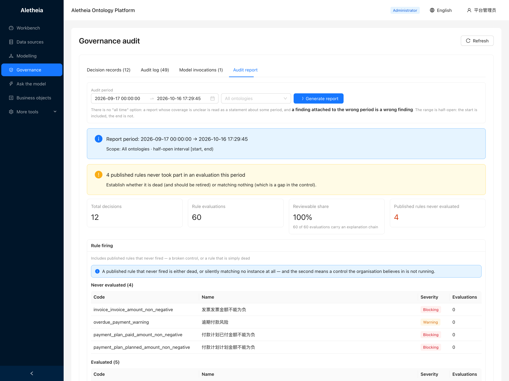

The raw audit log next door answers "what happened recently". This answers the questions an
auditor actually brings. Two of them are in this frame: which published rules never evaluated
anything this period (four), and how much of the period is re-examinable at all (100%: every
evaluation carries its explanation chain). The third, which releases overrode the gate, appears
when a period has one. The last question bounds the first two, because a conclusion with no
explanation chain cannot be reviewed by anyone.

The findings come first, because the backend already states what is worth looking at
("4 published rules never evaluated anything") and a UI that buries that in a table has thrown
away the analysis. The period has no "everything" option: a report whose coverage is unstated
gets read as a statement about a period it does not describe, and the header repeats the
half-open boundary so the reader never has to infer it.

## One instance, explained

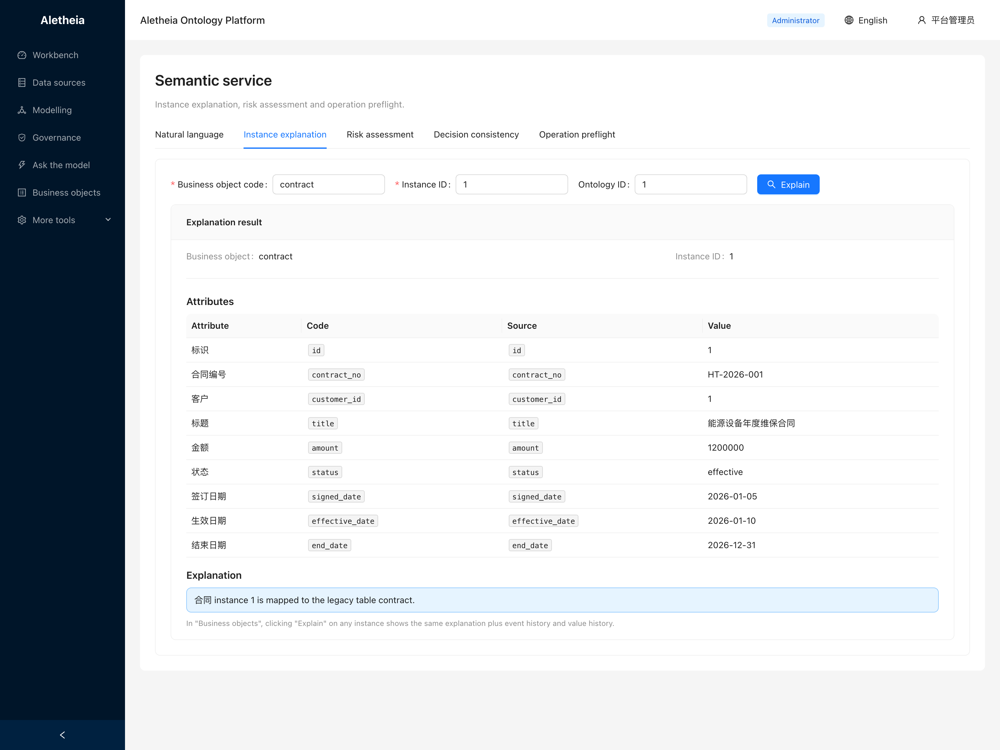

The platform's central claim rendered as a screen: a business object is consumed through one
stable interface, and every conclusion about it can be traced. Each attribute names the
column it was read from, so a wrong value is a mapping question rather than a data question.

Below that sit the two questions a reader arrives with next. "How did it get that way" is
the event history -- recorded against declared event types, because a stream of free-form
strings can be stored but not reasoned about. "What did it say last month" is the value
history: verdicts can be produced as of a past instant, so a reviewer who cannot see the old
values cannot check the old verdict. Both are read-only here; recording them is a modelling
act and belongs on a screen that says what it is doing.

## Declaring what can happen to an object

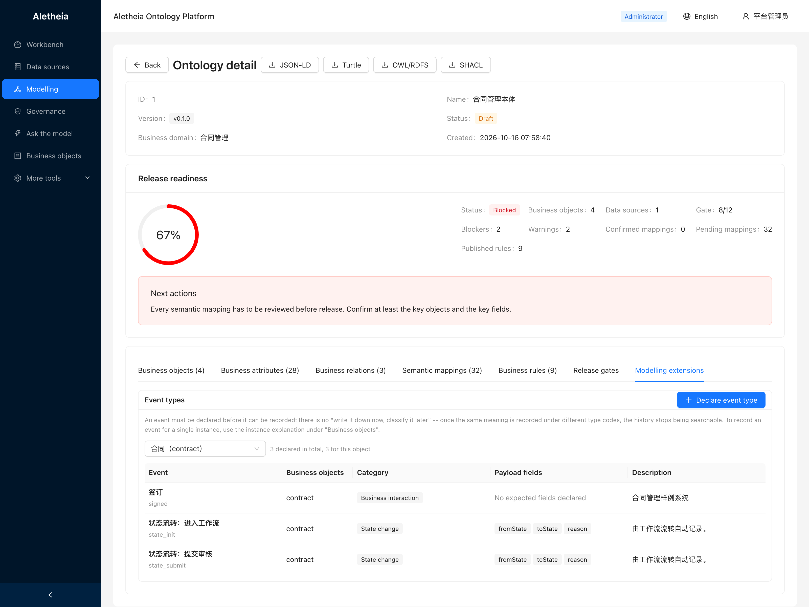

Event types are the reason this screen exists, and what is in frame is the declaration side:
this object's event types and the button that declares one. Recording an event whose code was
never declared is refused — deliberately, so that «驳回», «拒绝» and «rejected» cannot become three
unrelated facts and history stays queryable. The consequence is that a fresh deployment
records nothing, and until now the console offered no way to declare one: the instance
drawer said "declare an event type first" and pointed at nothing.

The split with the instance drawer is deliberate. Declaring a *kind* of event is a modelling
act and belongs here, next to the object it describes. Recording that *this* instance was
signed is an operational fact and belongs beside the instance. Payload fields are declared
as an expectation rather than a validation — a producer that omits one gets a note on the
event, not a rejected write, because refusing to record what actually happened is the one
thing an audit trail must never do.

## Model configuration for custom endpoints

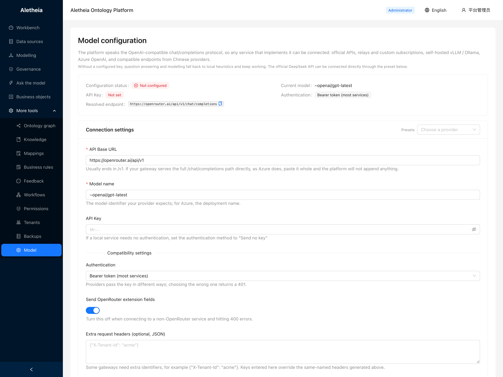

The platform speaks the OpenAI chat-completions protocol, so any service
implementing it works. A configurable base URL alone is not enough, because
providers differ in how they pass credentials and which extra body fields they
tolerate:

| Setting | Problem it solves |
|---|---|
| Auth style (bearer / api-key / custom / none) | Azure uses an `api-key` header; local servers often need no key |
| Provider extras toggle | vLLM and LM Studio reject unknown body fields with a 400 |
| Extra headers (JSON) | Some gateways require a tenant or group identifier |

Presets ship for OpenRouter, OpenAI, relay gateways, Azure, self-hosted vLLM and
DashScope, and the screen shows the full URL that will actually be called.

