# 界面与产出

> 15 张截图，每张说明它证明了什么，而不是展示界面好看。

返回 [中文 README](../README.zh-CN.md) · [English README](../README.md)

以下均为真实运行截图，非示意图或设计稿。数据来自内置的合成示例系统
（`examples/contract-system` 与设备运维样例），不含任何真实业务信息。

**两套图，一种语言一套**：界面是双语的，所以这一页显示默认（中文）截图，
`docs/screenshots.md` 显示英文截图，两者由同一条命令产出：

```bash
python scripts/capture_screenshots.py --token "$TOKEN" --user "$USER"                     # 中文
python scripts/capture_screenshots.py --token "$TOKEN" --user "$USER" --out docs/images/en --lang en
```

**界面改动之后用 `scripts/capture_screenshots.py` 重拍**——一张显示着产品已经没有的布局的截图，
是一句读者可以查证、并且会查到是假的断言。脚本把每条路由与文档引用的文件名配成一对，
需要的 id 从实例里读，其余全部来自 URL（`?tab=`、`?object=`、`?lang=`），因此同一条命令产出同一批图。
`tests/test_documentation_links.py` 两头都管：文档里出现的每张图必须存在，
`docs/images/` 里的每个文件也必须被文档引用。

## 工作台：一屏看清「接下来该做什么」

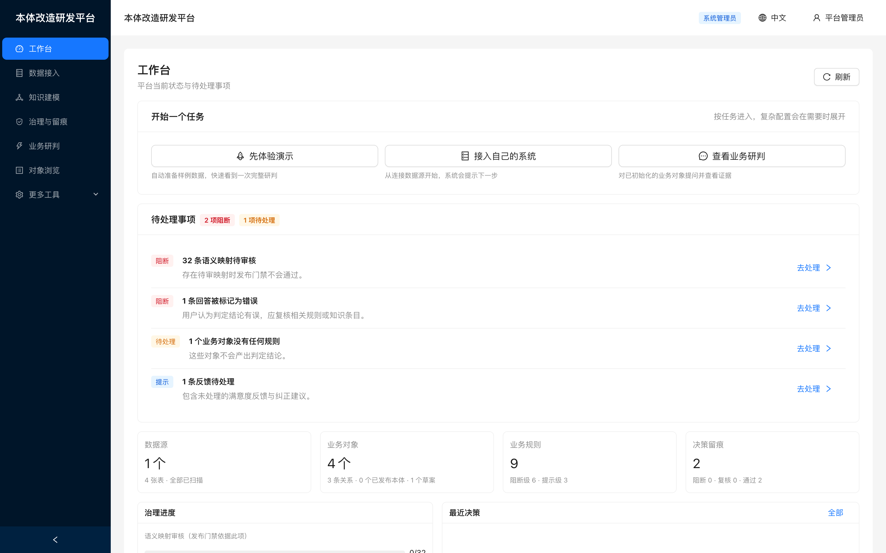

待处理事项按阻断优先排序，每条都指向可以处理它的页面。
所有数字都是既有表的只读投影，不会与它所汇总的页面产生分歧。

## 语义问答：结论 + 依据规则 + 证据

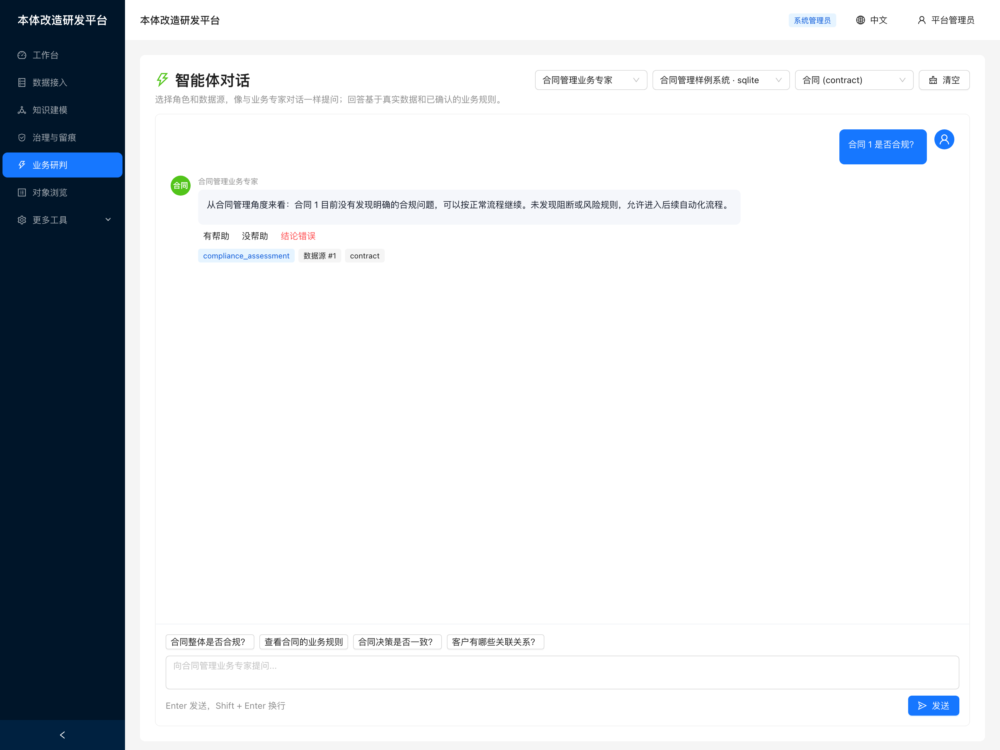

返回的不是一段自由文本，而是**结论加上结论的依据**：判定本身，
以及标出平台听懂了什么的标签——识别到的意图（`compliance_assessment`）、读的是哪个数据源、
问的是哪个业务对象。问规则或问一批实例时，回答会改用列表与表格呈现，回答的渲染器就是为此准备的。

每条回答都能打分（有帮助／没帮助／结论错误），评分连同问题一起落进反馈闭环——
「模型答得不对却没人发现」在这条链路上不可能发生。

页面上方的角色「合同管理业务专家」由已接入领域**运行时派生**——平台没有内置任何行业角色。

## 数据接入与元数据扫描

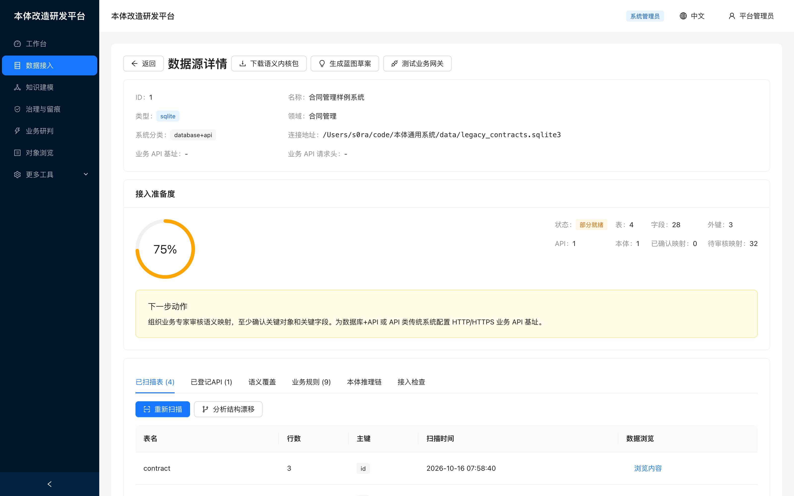

接入既有数据库后扫描出来的样子：表、字段、外键各自的数量，接入准备度评分，
以及由它得出的下一步。下面的标签页放着扫描到的表本身（含主键与行数）与登记在该数据源上的业务 API。
连接串里带密码时送达前端已脱敏；这一条是本地文件，没有可脱敏的段。

## 领域本体与业务对象

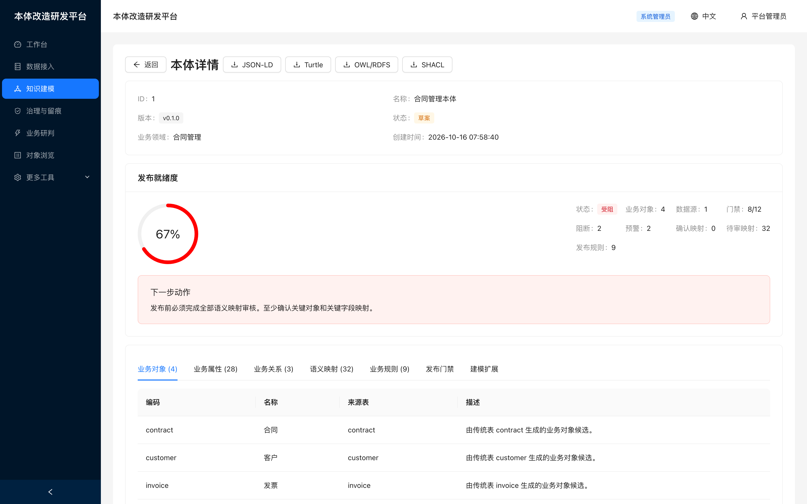

由元数据生成的本体草案：业务对象、属性、关系，以及每条语义映射的置信度与审核状态。

## 治理与发布门禁

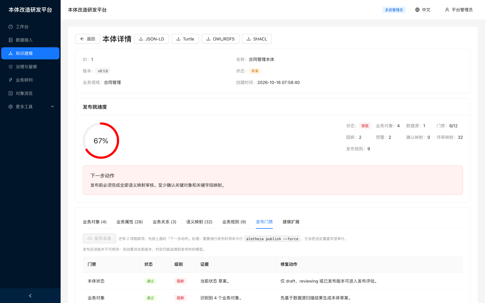

发布前评估 release-readiness。存在阻断项时拒绝发布，`force` 覆盖会连同
未通过门禁数一并写入审计。

## 角色与对象权限

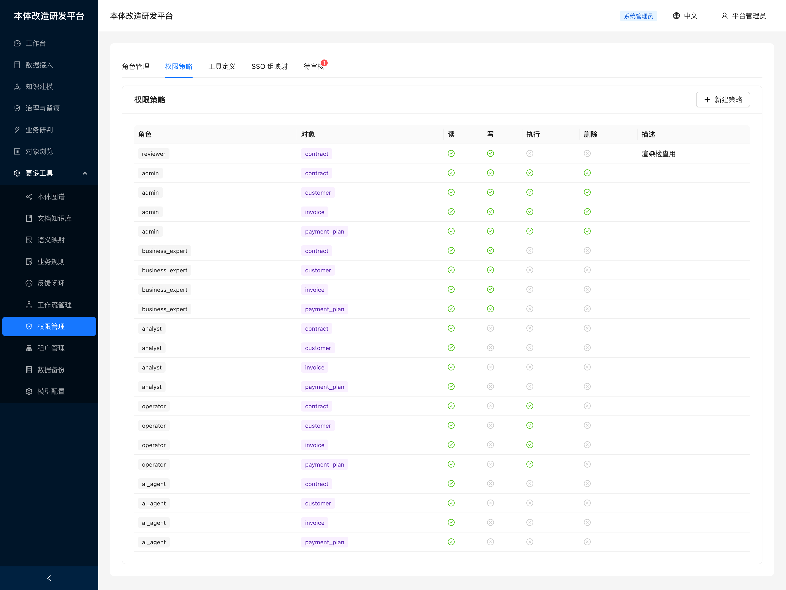

6 种能力 × 6 种角色，对象级读写执行删除策略。

> 一条策略可以带「行级过滤表达式」，而它**是真的在执行**：`check_permission` 在规则沙箱里求值它，
> 对象列表逐候选行应用并上报 `rowFilterApplied`，求不出值的表达式**拒绝**而不是放行。
> 代价（每读一行要判定一个候选行）见[当前限制](limitations.zh-CN.md)。

## 知识图谱预览

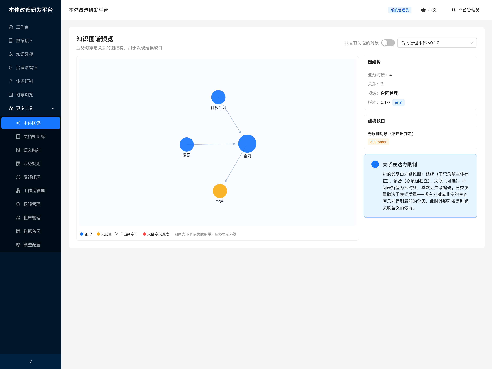

本体是图，但其余页面都以表格呈现，这会掩盖恰恰需要被看见的问题：
没有任何关联的孤立对象、自引用层级、以及不产出判定的对象簇。
颜色编码的是**诊断**而非装饰——红色表示未绑定来源表，橙色表示无规则。
圆圈大小为关联数量，悬停显示该关联依据的外键列。

边的类型由外键推断（组成／聚合／关联），中间表折叠为多对多，
视图同时说明：**分类质量的上限是模式质量**——源库没有外键或非空约束时，只能得到最弱的分类。

> 这段说明此前写的是「`relation_type` 恒为 `references`、无基数、无多对多」，
> 那是 ADR-0012 之前的实情。**一句低估已有能力的说明不是无害的遗留**：
> 它让读者不去期待产品已经具备的东西。

## 多租户隔离

按 [ADR-0006](adr/0006-tenant-isolation-model.md) 落地**双层隔离**——
两层的失效模式不重叠,任何单层出问题另一层仍拦得住:

| 层 | 作用 | 各方言实现 |
|---|---|---|
| **schema** | 挡住忘写租户过滤的查询 | PG `search_path`／MySQL database／SQLite 独立文件 |
| **`tenant_id`** | 把路由错误变成可见报错,而非静默跨租户读取 | 关键表加列 + 写入自动填充 |

共享表方案被否决的原因很具体:它把正确性押在「每条查询都记得加过滤」上,
而**漏写过滤在单租户测试数据下完全看不出来**。

租户标识受严格校验(`^[a-z][a-z0-9_]{0,38}$`)——它会被插入 DDL 与 `search_path`,
而这两处无法用绑定参数,因此必须先证明其安全。

`require_tenant()` 在无法确定租户时**拒绝而非猜测**,与 ADR-0002 同一立场。

## 文档知识库

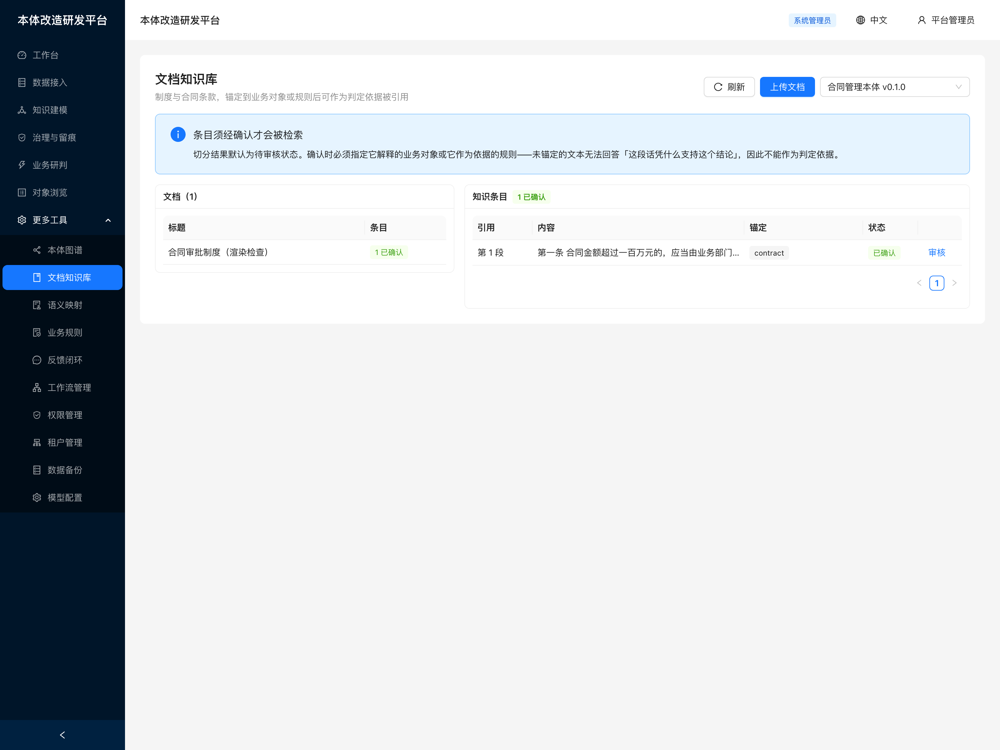

制度与合同条款按**条款编号**切分（`第3.2条`、`3.1`、`一、`、`Article 7`），
保留人类可引用的定位。两条治理约束写进了流程：

1. **条目默认 pending，未确认不可被检索。** 一段被错误切分的条款若直接成为判定依据，
   产生的是「看起来有据可查但依据是错的」——比没有依据更危险。
图中那份文档两步都走过：一条条款、已确认、锚定在 `contract` 上。

2. **确认时必须锚定**业务对象或规则。未锚定的文本无法回答
   「这段话凭什么支持这个结论」，因此不构成依据。

检索顺序是**先按锚定收窄候选，再排序**——这与「全库检索后看命中什么」方向相反，
也是引用可归因而非仅相似的原因。

## 反馈闭环

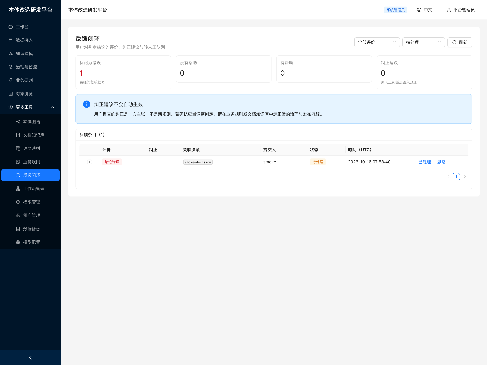

一个队列，一行一条。图中那一行是一次评分：读者把某个结论标成了「结论错误」，
并链回它对应的决策记录——「这个判定不对」只有在知道是哪个判定时才可行动。

两处刻意不做的设计：

1. **不提供满意度平均分。** 平均分不告诉你该修哪一条;按评价分类计数、
   「结论错误」排在最前，才是可行动的。
2. **不提供「一键应用纠正」。** 纠正是一方主张而非新规则，
   要成为规则或知识条目须走治理流程（ADR-0002）。

## 业务对象浏览：受治理的实例

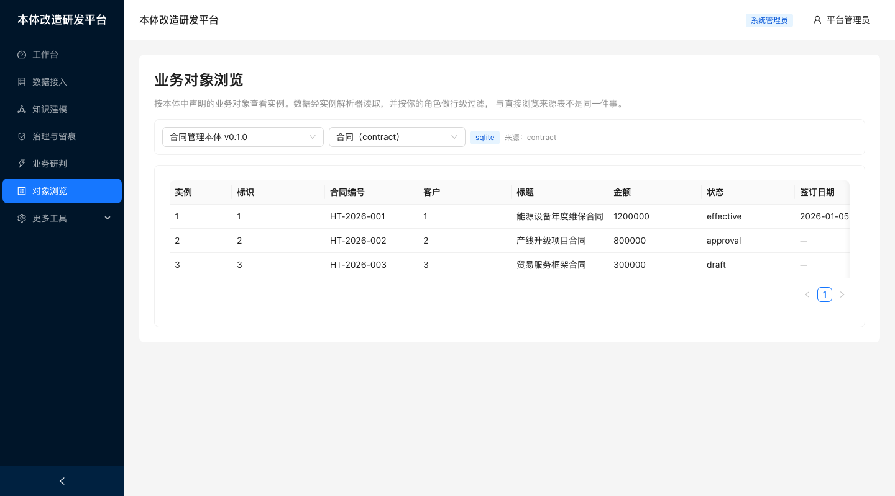

这是唯一一个把业务对象**当作对象**来看的界面：实例经实例解析器读取，列是本对象声明的属性，
并且套用调用者的行级过滤。右侧抽屉是**单个实例**：它读到的值各自来自哪一列、记在它身上的事件——取值沿革在更下面。
直接浏览来源表是另一回事——它绕过解析器、绕过过滤，
展示的是列而不是建模过的契约。

空表会说明是两种原因里的哪一种。**「你的角色看不到」与「过滤表达式无法求值」都不会返回任何行**，
而只有后者是有人能修的配置错误，因此平台把它写出来，而不是留给读者去猜。

## 租户与配额

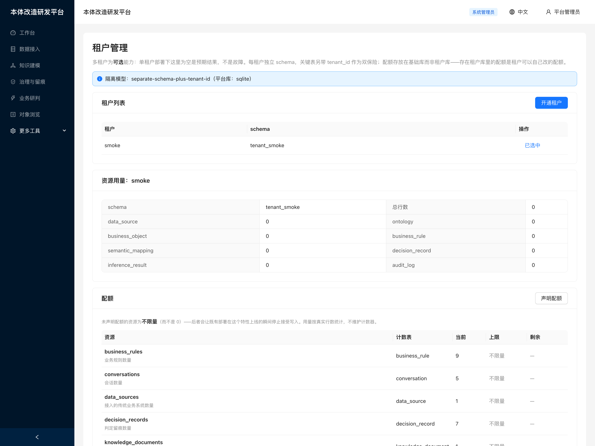

多租户是**可选**的，因此单租户部署下列表为空是预期结果而不是故障。页面把这一点写在最前面，
标明当前生效的隔离模型，并把用量与上限并排显示——**有上限没有用量回答不了运维真正的问题：
「这个租户是不是快被拦住了」**。未声明上限的资源显示为**「不限量」**，而不是一个大数字或 0——
未声明的配额是**放行**的，这是刻意的。

## 审计报表：审计员真正带来的问题

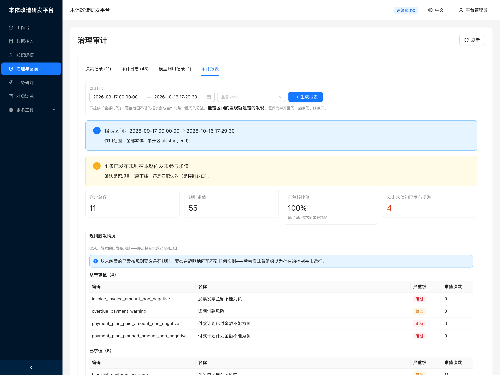

隔壁的原始审计日志回答「最近发生了什么」，这里回答审计员真正带来的问题，
而这一屏里有两个：
本期**哪些已发布规则一次都没求值**、哪些发布**覆盖了门禁**、
以及本期**究竟有多少是可复核的**——最后一项给前两项划定边界，
因为**没有解释链的结论谁也复核不了**。

`findings` 排在最前面：后端已经把「值得看什么」写出来了（「4 条已发布规则本期从未求值」），
界面若把它埋进表格里，等于把这份分析扔掉。区间不提供「全部时间」——
覆盖范围不明的报表会被读成对一个它并未描述的区间的陈述；
表头同时复述半开区间，读者不必自行推断。

## 一个实例，完整解释

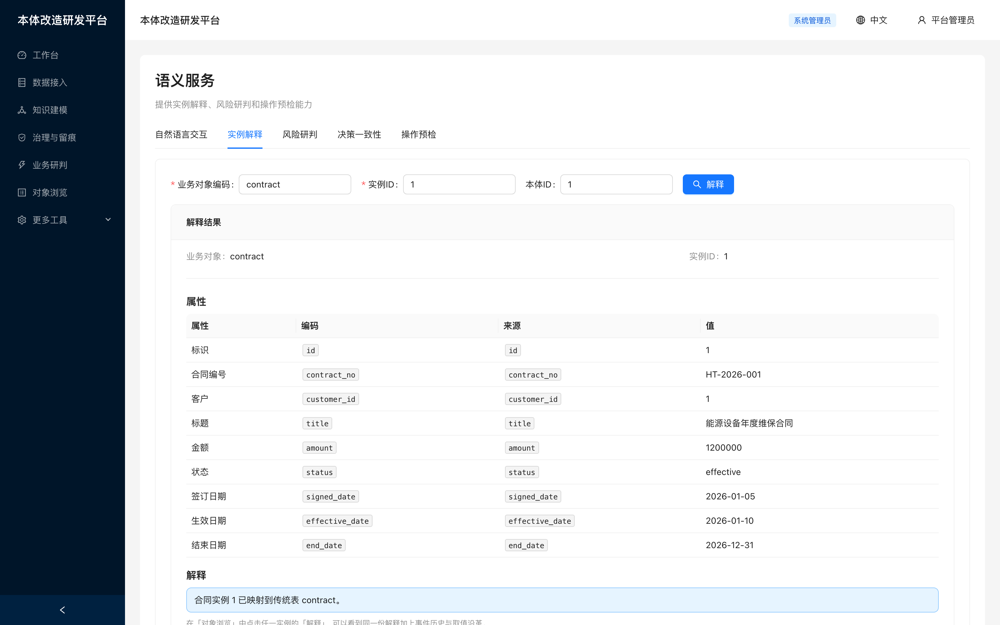

平台的核心主张在这里变成了一屏：业务对象经一条稳定接口消费，且关于它的每个结论都可回溯。
每个属性都标出它读自哪一列——**值不对时，问题出在映射上而不是数据上**。

再往下是读者接着会问的两个问题。「它怎么会变成这样」由事件历史回答：
事件记录在**已声明的事件类型**上，因为一串自由文本存得下、推理不了。
「它上个月是什么」由取值沿革回答：判定可以按过去某一时刻产出，
看不到当时取值的复核者，也就复核不了当时的结论。
两处都只读——记录它们是建模动作，该放在说明自己在做什么的界面上。

## 声明一个对象上能发生什么

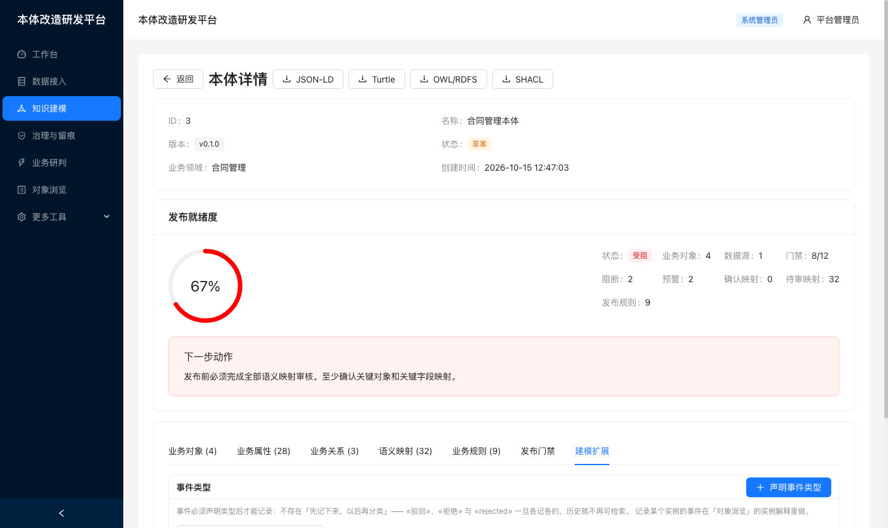

这个界面是为**事件类型**而存在的，图中是**声明的那一侧**：这个对象的事件类型，以及声明它的按钮。
记录一个从未声明过的事件编码会被拒绝——
这是刻意的：«驳回»、«拒绝» 与 «rejected» 一旦各记各的，历史就不再可检索。
代价是全新部署下什么都记不下来，而此前控制台没有任何地方能声明它：
实例解释里写着「事件类型需先声明」，却没有指向任何可操作的地方。

与实例抽屉的分工是刻意的：声明**一类**事件是建模动作，属于对象这一侧；
记录**这个**实例被签订了是运行事实，属于实例那一侧。
载荷字段声明的是期望而非校验——生产方漏掉一个字段会在事件上留一条标注，而不是拒绝写入，
因为「拒绝记录真实发生过的事」是审计留痕唯一绝不能做的事。

## 模型配置：适配自定义订阅

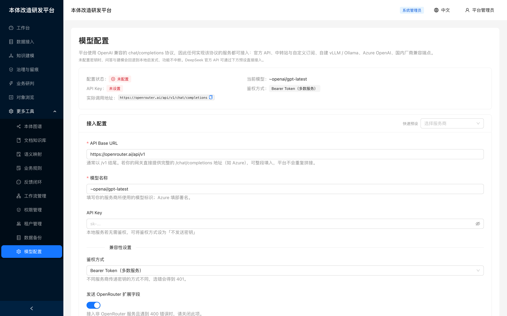

平台使用 OpenAI 兼容的 chat/completions 协议，因此任何实现该协议的服务都可接入。
仅可配 Base URL 是不够的——各家在**如何传密钥**与**能容忍哪些额外字段**上并不一致，
因此另有兼容性设置：

| 设置 | 解决的问题 |
|---|---|
| 鉴权方式（bearer／api-key／自定义／不发送） | Azure 用 `api-key` 头；本地服务常无需密钥 |
| 发送 OpenRouter 扩展字段（可关闭） | vLLM、LM Studio 等对未知字段直接返回 400 |
| 附加请求头（JSON） | 部分网关需要租户或分组标识 |

内置 OpenRouter／OpenAI／中转站／Azure／自建 vLLM／阿里云百炼预设，
并显示**实际会被调用的完整地址**。未配置密钥时回退本地启发式，功能不中断。

完整配置项与排错见[接入自定义模型服务](model-endpoints.zh-CN.md)。

